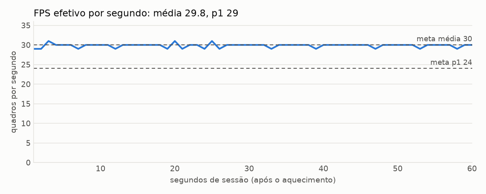
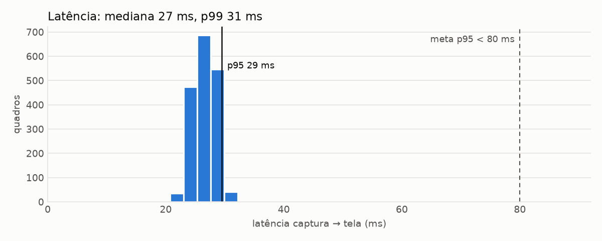

# Desempenho

Sessão de **60 s** (mais 3 s de aquecimento descartados) em 25/09/2026 16:26. Gerado por `python tools/benchmark.py`.

## Resultado contra as metas

| Métrica | Meta | Medido | Resultado |
| --- | --- | --- | --- |
| FPS efetivo médio (vídeo + peça atualizados) | ≥ 30 | 29.8 | ✅ passou |
| FPS efetivo p1 (janelas de 1 s) | ≥ 24 | 29.0 | ✅ passou |
| Latência captura → tela p95 | < 80 ms | 29 ms | ✅ passou |
| Sessão válida (pessoa detectada) | ≥ 80% | 100% | ✅ passou |

**Todas as metas foram atingidas.** O FPS efetivo é o ritmo em que vídeo e peça se atualizam juntos; é limitado pela webcam (30 FPS nominais), por isso a média tem tolerância de ±0.5 FPS (cada janela de 1 s conta quadros inteiros).





## Taxas

| Fluxo | Média | p1 (janelas de 1 s) | Mínimo |
| --- | --- | --- | --- |
| Vídeo + peça na tela | 29.8 | 29 | 29 |
| Pose (landmarks novos) | 29.8 | 29 | 29 |
| Laço de render (vsync) | 165 | 163 | 162 |

Pior 1% dos quadros do laço de render: 135 FPS equivalentes (o render roda muito acima da câmera, então não é o gargalo).

## Latência captura → tela

| Média | p50 | p95 | p99 | Máx. |
| --- | --- | --- | --- | --- |
| 27 ms | 27 ms | 29 ms | 31 ms | 47 ms |

Medida do instante em que o driver entrega o quadro até o fim do desenho na tela (inclui a pose desse quadro, o retarget e a espera do vsync, porque o vídeo exibido é o quadro que gerou a pose). **Não inclui a latência interna da webcam** (sensor → driver), que não é observável por software.

## Orçamento por estágio

| Estágio | Onde | Média | p95 | Máx. | Plano |
| --- | --- | --- | --- | --- | --- |
| Estimativa de luz | CPU, a 10 Hz | 3.9 ms | 5.1 ms | 22.9 ms | - |
| Pose (MediaPipe, CPU) | inferência | 16.3 ms | 17.4 ms | 37.3 ms | 15 ms |
| Render (envio dos comandos) | CPU | 0.4 ms | 0.5 ms | 3.4 ms | 3 ms |
| Retarget + oclusor | CPU, thread principal | 1.5 ms | 1.8 ms | 4.0 ms | - |
| Segmentação (ONNX, GPU) | inferência | 7.9 ms | 9.2 ms | 11.0 ms | 12 ms |
| Espera do vsync | bloqueado, sem GIL | 5.0 ms | 6.5 ms | 7.4 ms | - |
| Troca de peça (tecla → tela) | evento | 5.7 ms | 6.7 ms | 6.7 ms | - |
| Envio do quadro à GPU | CPU | 0.6 ms | 0.8 ms | 1.3 ms | - |

Pose e segmentação rodam em threads paralelas, então o custo por quadro é o do estágio mais lento, não a soma.

## Recursos

| Recurso | Média | Máx. |
| --- | --- | --- |
| CPU do processo (núcleos equivalentes) | 2.1 | 3.0 |
| CPU total do sistema | 18% | 28% |
| RAM do processo | 808 MB | 947 MB |
| GPU (utilização) | 37% | 44% |
| VRAM usada (toda a GPU) | 507 MB | 507 MB |
| Temperatura da GPU | 62 °C | 64 °C |

## Ambiente

- **Máquina:** SIB-N30064472
- **SO:** Windows-10-10.0.26200-SP0
- **CPU:** Intel64 Family 6 Model 141 Stepping 1, GenuineIntel (8c/16t)
- **RAM:** 15.7 GB
- **OpenGL (renderer):** NVIDIA GeForce RTX 3060 Laptop GPU/PCIe/SSE2
- **Python:** 3.11.16
- **GPU:** NVIDIA GeForce RTX 3060 Laptop GPU, 6 GB, driver 610.60
- **mediapipe:** 1.0.1
- **onnxruntime-directml:** 1.24.4
- **moderngl:** 5.12.0
- **glfw:** 2.10.2
- **opencv-python:** 5.0.0.93
- **numpy:** 2.4.6

## Configuração da sessão

- **Resolução da câmera:** 1280x720
- **Peças no catálogo:** 6
- **Troca de peça automática:** a cada 5 s
- **Segmentação:** DirectML gpu0
- **Cenário:** fundo real
- **Luz adaptativa:** ligada
- **FOV horizontal:** 70°
- **Erro médio das articulações:** 6.9 px

## Como reproduzir

```
python tools/benchmark.py --seconds 60
```

Fique de frente para a câmera, com ombros e cintura visíveis. Nos primeiros 20 s, parado; depois mova os braços e gire o tronco. O benchmark troca de peça sozinho a cada 5 s. Feche outros apps que usem a webcam (eles a dividem e derrubam o FPS).

Dados brutos: `benchmarks/20260925_1626.json` (fora do git).
